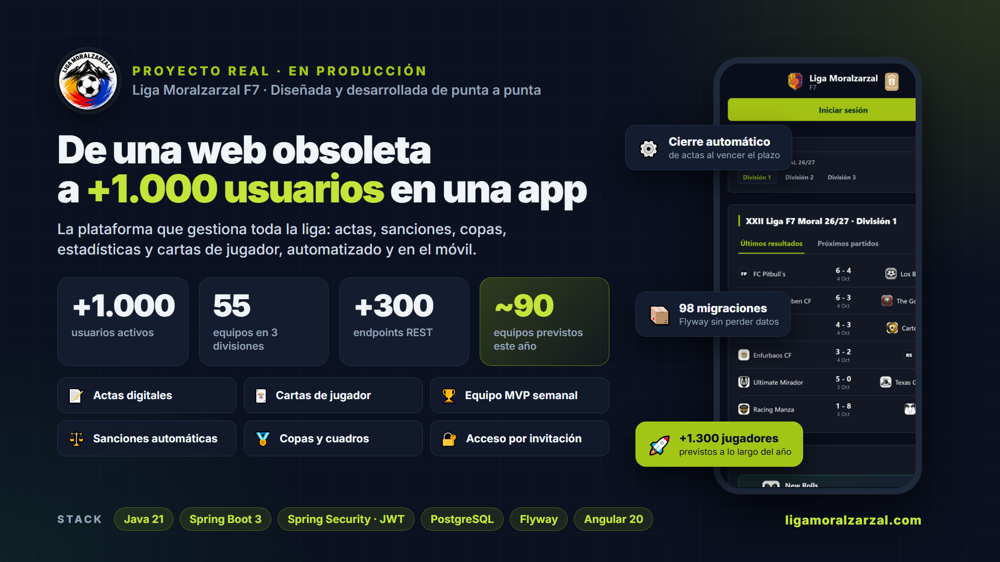
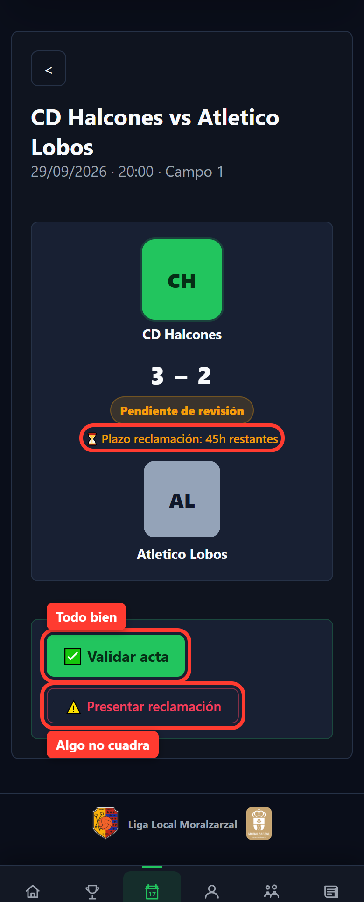
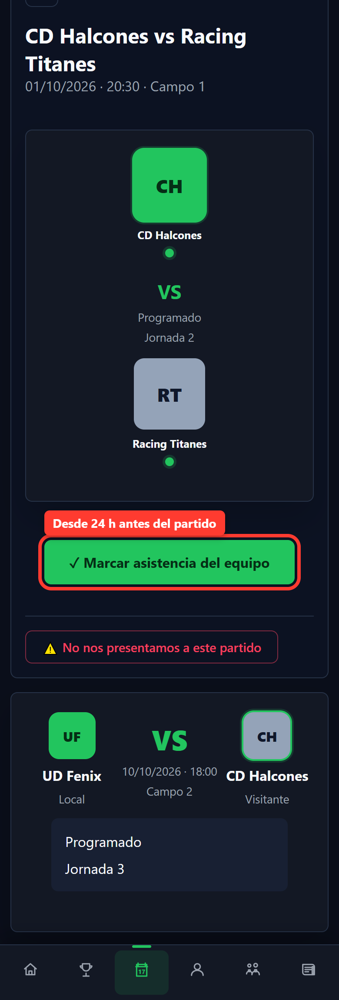
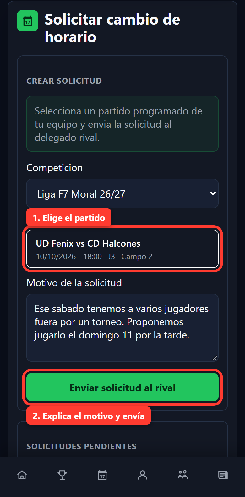
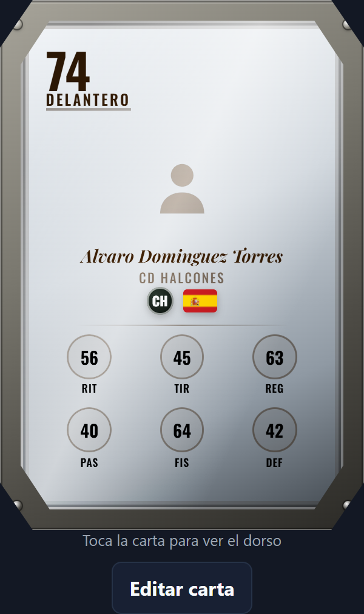
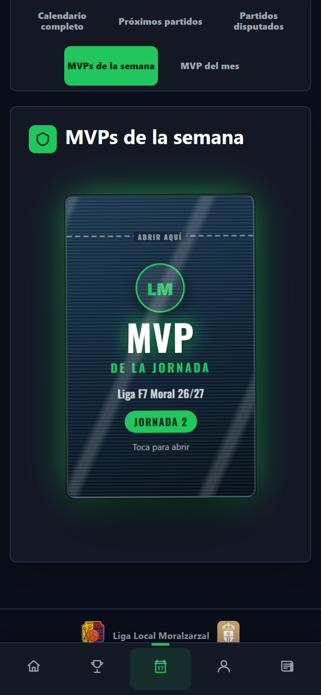
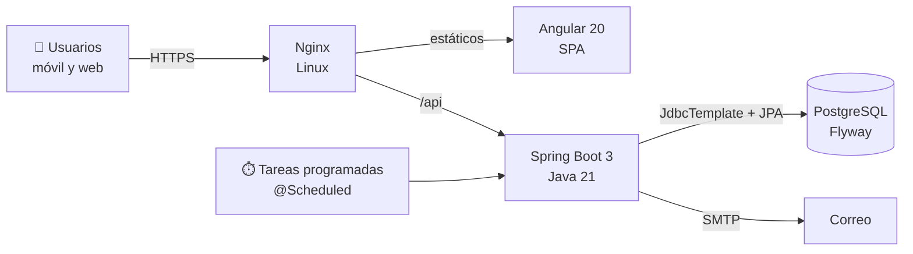

# ⚽ Liga Moralzarzal F7

**Plataforma oficial de la liga municipal de fútbol 7 de Moralzarzal (Madrid), en producción en [ligamoralzarzal.com](https://ligamoralzarzal.com).**

La he diseñado, desarrollado, desplegado y la mantengo yo solo, de principio a fin. Sustituyó a una web antigua en la que casi todo se hacía a mano: hoy la usan **más de 1.000 usuarios y 55 equipos** cada semana.

> El código fuente completo está en repositorios privados porque la aplicación gestiona datos personales reales de jugadores. Este repositorio muestra la arquitectura, las funcionalidades y algunos fragmentos de código representativos. Si quieres ver más, escríbeme y te lo enseño en una entrevista.

---

## 📊 En cifras

| | |
|---|---|
| 👥 Usuarios | **+1.000** (jugadores, delegados, capitanes, árbitros y administradores) |
| 🏟️ Equipos | **55**, en varias divisiones y categorías |
| ⚙️ API REST | **60+ controladores** y **300+ endpoints** |
| 🗄️ Base de datos | PostgreSQL con **98 migraciones Flyway** aplicadas en producción sin perder datos |
| 🖥️ Frontend | Angular 20, más de 30 pantallas, pensado para el móvil |
| 🧪 Testing | ~330 peticiones de integración contra la API con 11 roles distintos, sobre PostgreSQL en Docker |

## ✨ Funcionalidades

- **Actas digitales:** el acta del partido se rellena desde el móvil. El rival la valida o presenta una reclamación dentro de un plazo, y si nadie reclama se cierra sola.
- **Sanciones automáticas:** acumulación de amarillas, dobles amarillas y rojas. La sanción se calcula sobre los partidos que juega cada equipo y se cumple sola según el calendario.
- **Calendario y cambios de horario:** generación del calendario por franjas. Un equipo pide al rival un cambio de horario desde la app, con plazo y respuesta.
- **Copas y supercopa:** fases de grupos, cuadros eliminatorios y avance automático cuando el acta pasa a oficial.
- **Cartas de jugador:** cada jugador tiene una carta con una media que evoluciona según su rendimiento.
- **Equipo MVP de la semana y jugador del mes**, por división y categoría.
- **Árbitros:** asignación a partidos y valoración por parte de los equipos.
- **Acceso solo por invitación:** cada usuario está vinculado a su equipo real, con roles y permisos (SuperAdmin, admin de campo, delegado, capitán, jugador y árbitro).
- **Notificaciones por correo:** invitaciones, avisos y detección de correos que rebotan.
- **Auditoría** de acciones y estadísticas de uso de la app.

## 📱 Capturas

> Capturas hechas con datos de demostración.

| Acta | Asistencia | Cambio de horario | Carta de jugador | MVP |
|---|---|---|---|---|
|  |  |  |  |  |

## 🏗️ Arquitectura

**Backend** (`Java 21 · Spring Boot 3`)
- API REST por capas: `web` (controladores), `service`, `repository`, `domain`, `scheduler` y `config`.
- **Spring Security + JWT** sin estado, con roles globales y por equipo, y una comprobación de permisos centralizada en cada operación.
- **JdbcTemplate** para las consultas complejas (clasificaciones, sanciones, estadísticas) y **Spring Data JPA** para las entidades principales.
- **Flyway** para versionar el esquema: 98 migraciones aplicadas en producción sin perder datos.
- Tareas programadas: cierre automático de actas, avance de copas y lectura de correos rebotados.

**Frontend** (`Angular 20 · TypeScript`)
- SPA con componentes standalone y signals, adaptada al móvil.

**Despliegue**
- Servidor Linux con Nginx como proxy inverso y el backend como servicio systemd.
- Script de despliegue que guarda una copia de la versión anterior antes de sustituirla, para poder volver atrás.
- Toda la configuración sensible va en variables de entorno, nunca en el código.

## 🧩 Fragmentos de código

- [`ActaScheduler.java`](samples/backend/ActaScheduler.java): tarea programada que cada hora cierra las actas cuyo plazo de reclamación ha vencido y, en la misma transacción, aplica las sanciones, actualiza las cartas de jugador y hace avanzar las copas.
- [`AutomaticSanctionService.java`](samples/backend/AutomaticSanctionService.java): reglas de sanciones automáticas (acumulación de amarillas, dobles amarillas, cumplimiento por partidos jugados) en SQL con JdbcTemplate.
- [`samples/db`](samples/db): ejemplos de migraciones Flyway.

## 🛠️ Stack

## 👤 Autor

**Carlos Rodríguez Ruiz**, desarrollador backend Java.

